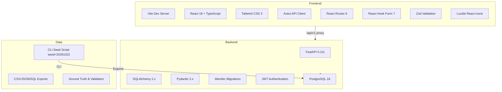

# PricePilot AI

A deterministic pricing platform for AI/ML-powered price optimization.

## Overview

PricePilot AI is a complete end-to-end pricing platform built with a three-tier architecture:

- **Frontend**: React 18 + TypeScript + Vite + Tailwind CSS + Recharts
- **Backend**: FastAPI + SQLAlchemy + Pydantic + Alembic + PostgreSQL 18
- **Data**: Deterministic synthetic data generation with seed 20261022

## 13 Functional Pages

| Page | Path | Description |
|------|------|-------------|
| Login | `/login` | Authentication page |
| Dashboard | `/` | KPI dashboard with real DB data |
| Products | `/products` | Product catalog management |
| Costs | `/costs` | Cost history tracking |
| Inventory | `/inventory` | Inventory level monitoring |
| Competitors | `/competitors` | Competitor price monitoring |
| Promotions | `/promotions` | Promotion & discount management |
| Simulator | `/simulator` | Pricing simulation engine |
| Decision Center | `/decisions` | Pricing decision approval workflow |
| Exceptions | `/exceptions` | Edge case & constraint violation tracking |
| Analytics | `/analytics` | Reports & derived metrics from DB |
| Audit | `/audit` | Immutable action log for compliance |
| Settings | `/settings` | Platform configuration (admin only) |

## Architecture



## Key Features

- **Deterministic data**: Seed 20261022; starter 100 SKUs/30 days/50 promos; full 5,000 SKUs/180 days/2,000 promos
- **Pricing mechanics**: Floor, ceiling, margin, signals; full explainability
- **Five required edge cases**: PRICE_BELOW_FLOOR, PROMOTION_STACK_VIOLATION, STALE_COMPETITOR_OBSERVATION, INCORRECT_MARGIN_CALCULATION, MISSING_PRICE_CHANGE_REASON
- **RBAC**: Writes require ADMIN/PRICING_MANAGER; user admin requires ADMIN
- **Only APPROVED decisions** write PriceHistory; blocked decisions remain proposals
- **Stale competitor observations** are FLAGGED warnings with signal excluded, not hard-blocked
- **AS_OF_DATE=2026-01-31** drives freshness, promotion lifecycle, and demo dataset logic
- **Alembic migration** is schema source of truth; `Base.metadata.create_all` idempotent startup fallback

## Authentication

Three roles are supported:

| Role | URL | Permissions |
|------|-----|-------------|
| `analyst@pricepilot.ai` / `Analyst@12345` | Read-only | Dashboard, Products, Costs, Inventory, Competitors, Analytics, Audit, Settings (read-only) |
| `manager@pricepilot.ai` / `Manager@12345` | Read + write | Products, Costs, Inventory, Competitors, Promotions, Decisions (approve/block) |
| `admin@pricepilot.ai` / `Admin@12345` | Full access | All pages, system settings, user management, database operations |

## Development

### Prerequisites

- Python 3.12+
- Node.js 20+
- PostgreSQL 18

### Setup

```bash
# Backend
cd backend
python -m venv .venv
source .venv/bin/activate
pip install -r ../requirements.txt
cp .env.example .env  # Edit with your PostgreSQL credentials
alembic upgrade head

# Frontend
cd frontend
npm install
cp .env.example .env  # VITE_API_BASE_URL proxy defaults to http://127.0.0.1:8000
npm run dev  # Vite dev server on http://127.0.0.1:5173

# Startup
# 1. Start PostgreSQL
# 2. Start backend: uvicorn app.main:app --host 0.0.0.0 --port 8000
# 3. Start frontend: npm run dev
# 4. Visit http://127.0.0.1:5173, login with analyst@pricepilot.ai / Analyst@12345
```

### Build

```bash
cd frontend
npm run build  # Produces dist/ for production deployment
```

### Testing

```bash
# Backend
cd backend
python -m pytest tests/ -v

# Frontend
cd frontend
npm run test  # Vitest + React Testing Library
```

### Deployment

- **Docker**: `docker-compose up --build`
- **Kubernetes**: Manifests available in `deployment/`
- **Static frontend**: Serve `frontend/dist/` with any static file server (Nginx, Caddy, etc.)

## API Documentation

- **Swagger UI**: `http://127.0.0.1:8000/api/docs`
- **OpenAPI JSON**: `http://127.0.0.1:8000/api/openapi.json`

## 13 Pages - Quick Navigation

1. **Login** (`/login`) - Authenticate with one of three roles
2. **Dashboard** (`/`) - KPIs from actual DB records: revenue, gross profit, margin, inventory
3. **Products** (`/products`) - 100 SKU catalog with filtering and search
4. **Costs** (`/costs`) - Cost history with floor/ceiling validation
5. **Inventory** (`/inventory`) - Stock levels, reorder points, overstock detection
6. **Competitors** (`/competitors`) - Price deviations with staleness warnings
7. **Promotions** (`/promotions`) - Active promotions with eligibility scoring
8. **Simulator** (`/simulator`) - Run pricing scenarios with floor/ceiling checks
9. **Decision Center** (`/decisions`) - Save/approve/block pricing decisions
10. **Exceptions** (`/exceptions`) - Track edge cases and constraint violations
11. **Analytics** (`/analytics`) - Revenue trends, margin analysis, validation reports
12. **Audit** (`/audit`) - Immutable log of all system actions
13. **Settings** (`/settings`) - Platform configuration (admin only)
```

## Version

`PricePilot AI v1.0.0` - Deterministic pricing platform with full explainability.